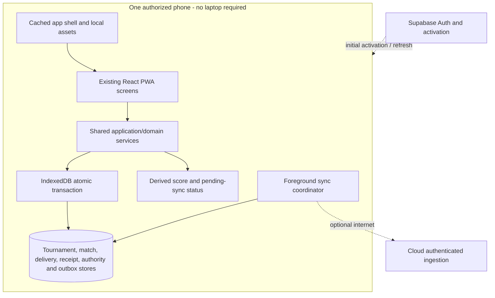
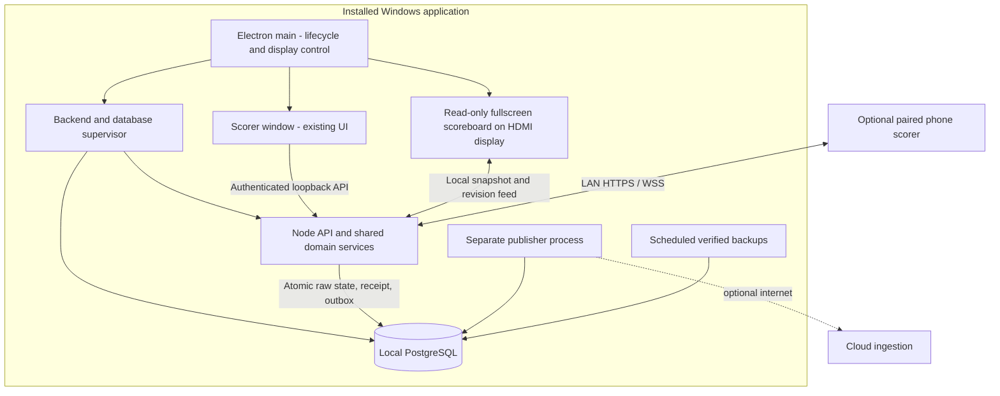
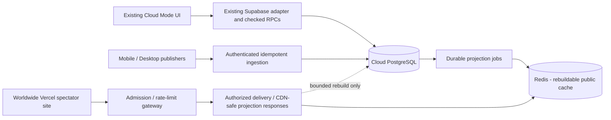

# Crease 2.0 architecture

Date: 28 November 2026. Status: **proposed architecture, not an implementation**.

This document extends the [codebase audit](../CREASE_CODEBASE_AUDIT.md) and is paired with the [development roadmap](./CREASE_2_DEVELOPMENT_ROADMAP.md). Only these planning documents are being created. No source, dependency, schema, deployment or existing test changes are part of this task.

## 1. Evidence and scope

**Verified by repository inspection:** the working branch is `feature/local-first`, HEAD is `7fb43b7`, and the application currently uses the cloud Supabase backend, a delivery-derived cricket engine, browser localStorage scoring drafts, revision-checked scoring RPCs and a generated PWA worker. Electron, a production local PostgreSQL service, IndexedDB scoring authority and Redis spectator infrastructure are not implemented.

**User-supplied verified baseline:** 355 application tests across 59 files, 24 database integration tests, 379 total tests, successful production build and successful PWA service-worker generation. These results are the migration baseline; they were not rerun during this documentation task.

**Proposed:** everything described below as a Crease 2.0 component, protocol or release gate. **Unresolved:** items explicitly listed in section 17. Source inspection does not establish the cause of the earlier production outage or certify spectator capacity.

The earlier audit recommended a local PostgreSQL host and considered browser persistence insufficient as a shared LAN server. The new requirement adds an independent **single-phone authority**. That is feasible without making the phone a LAN server: Mobile Mode owns its tournament locally and does not require a laptop, TV, incoming connections or background execution while the browser is closed.

## 2. Decisions and rationale

| Decision | Proposed choice | Rationale and boundary |
|---|---|---|
| D01: retain Cloud Mode | Existing Supabase adapter remains the default throughout migration | Protect the deployed release and allow incremental rollout |
| D02: one cricket implementation | Shared TypeScript domain services and versioned commands | Reuse the engine, rules, aggregation and presentation rather than port cricket independently to SQL or another language |
| D03: Mobile authority | IndexedDB transactions on one activated phone per tournament | Phone-only management/scoring; no server dependency for commits |
| D04: Desktop authority | Node service with local PostgreSQL, packaged with Electron | Reuse PostgreSQL persistence/security semantics; provide managed Windows startup and HDMI display |
| D05: identity | Supabase Auth subject remains the canonical user identity | Offline capabilities are delegations of the same account, not a second password/account system |
| D06: authority | Tournament authority ID and monotonically increasing epoch; explicit transfers | Prevent cloud/mobile/desktop accepting independent canonical writes |
| D07: synchronization | Transactional local outbox; idempotent ordered cloud ingestion | Cloud acknowledgment never gates a local commit |
| D08: spectators | Compact cloud PostgreSQL projections, Redis, admission gateway and CDN | Separate public fan-out from scoring and avoid repeated raw-history downloads |
| D09: licensing | Signed lifetime local entitlement, separate cloud-service entitlement | A spectator subscription outage/expiry must not stop activated local scoring |
| D10: packaging | Separate cloud/mobile-web and desktop build outputs | A Cloudflare worker bundle is not a Windows backend executable |
| D11: isolation | Scoped transactions, tenant/tournament validation and explicit public DTOs | No global scoring lock or cross-installation data/cache leakage |
| D12: operational safety | No automatic authority takeover or mid-tournament update | Prefer explicit recoverable pauses over divergent histories or surprise reloads |

## 3. Technology and module boundaries

### Existing assets to preserve

The current [manifest](../package.json) declares React `^19.2.0`, TanStack Query `^5.101.1`, Router `1.170.41`, Start `1.168.60`, Supabase JS `^2.118.0`, Vite `8.1.5`, TypeScript `^5.8.3`, Tailwind `^4.2.1`, Nitro `3.0.260603-beta` and PWA plugin `^2.0.0`. The current Lovable Vite wrapper is **2.27.1**, newer than the 2.26.5 declaration recorded in the earlier audit. Lockfiles, not these ranges alone, determine a reproducible installation. Do not change them in the planning phase.

Keep [engine.ts](../src/lib/cricket/engine.ts), [fixture-generator.ts](../src/lib/cricket/fixture-generator.ts), [playoffs.ts](../src/lib/cricket/playoffs.ts), [tournament.ts](../src/lib/cricket/tournament.ts), [tournament-summary.ts](../src/lib/cricket/tournament-summary.ts), [match-award.ts](../src/lib/cricket/match-award.ts) and [TV event selection](../src/lib/cricket/tv-highlights.ts) as the behavioral starting point. [match.ts](../src/lib/cricket/match.ts) currently mixes derivation, database-shaped types and React/Supabase transport, so it needs a small extraction seam before reuse in workers or Node.

### Proposed layers

1. **Domain:** dependency-free types, deterministic command validation/reduction, match derivation, standings, NRR, statistics, awards and fixture/playoff graph logic. No React, Supabase client, Electron, IndexedDB or network imports.
2. **Application services:** authorize command using verified capability and current local policy, load relevant state, invoke domain rules, commit atomically, notify observers. Each command has a version and a deterministic outcome.
3. **Ports:** `TournamentRepository`, `ScoringRepository`, `AtomicUnitOfWork`, `IdentityProvider`, `CapabilityVerifier`, `AuthorityRegistry`, `OutboxStore`, `ChangeFeed`, `AssetStore`, `BackupService` and `PublicProjectionReader`. These are proposed interface names, not existing files.
4. **Adapters:** existing Cloud/Supabase, Mobile/IndexedDB, Desktop/PostgreSQL behind Node, and read-only cloud spectator HTTP. UI selects a mode explicitly; a network error never silently switches authority or database.
5. **Hosts:** current web/PWA, Electron renderer/main/service processes and cloud ingestion/projection workers.

Repository ports describe domain operations, not generic unrestricted table CRUD. A commit returns a durable receipt, new revision and change notification data. Implementations must support expected-revision comparison and receipt/outbox writes in the same transaction. External I/O must not run inside that transaction.

The current SQL contains cricket-related validation, including Super Over transitions. Keep it intact for Cloud Mode initially. Later, the same shared command validator runs in trusted Node/cloud application services and the Mobile worker; database constraints still enforce identity, ownership, uniqueness, legal states and concurrency. Where SQL checks must temporarily coexist with shared rules, use differential tests and document the duplication as transitional. Mobile-generated events are untrusted at cloud ingestion and must be revalidated server-side with the same domain version.

New package choices for IndexedDB convenience, Node HTTP, Redis client, Electron installer and supported Node/PostgreSQL/Electron versions require compatibility spikes. No dependency or version upgrade is authorized by this document.

## 4. Operating modes

### 4.1 Mobile Mode



All tournament operations needed for play must use the local repository: creation, teams, fixtures, settings, scoring, undo, playoffs, awards and recovery. Caching only the score page is insufficient. Existing data must be explicitly downloaded and transferred before disconnected management. A previously activated phone may create a new locally owned tournament offline under its signed creation capability; first-ever identity verification/activation still needs connectivity.

Proposed IndexedDB stores cover installation/capabilities, authority records, tournaments, teams/groups, matches, raw deliveries, operations/receipts, outbox, checkpoints, settings, award publications and assets. Use globally unique IDs and compound indexes scoped by owner/tournament/match and stream sequence. Store raw cricket facts; totals are rebuildable local projections.

Within one read-write transaction, validate stored authority/expected revision, apply raw changes, retain audit history, increment revisions, insert the receipt and append the outbox event. Report “saved on this phone” only after transaction completion. A reducer can prepare a change outside the transaction, but the transaction must reject a stale base revision before applying it. Do not await network or unrelated asynchronous work inside an IndexedDB transaction.

Use a single writer coordinator per installation, with Web Locks where supported, plus transactional revision checks as the correctness boundary. A second tab is an observer or must obtain the same writer coordination; BroadcastChannel alone is not a lock. Test fallback behavior when browser APIs are missing. Pending sync and local unsaved state are different states.

Request persistent storage where supported, monitor quota, warn before exhaustion and offer encrypted export. IndexedDB remains subject to browser/profile loss and user deletion; persistence requests are not a guarantee. See [MDN storage quotas and eviction](https://developer.mozilla.org/en-US/docs/Web/API/Storage_API/Storage_quotas_and_eviction_criteria). A closed/suspended mobile browser may not run synchronization. Correctness must depend on the durable outbox and resume processing, not on Background Sync availability.

### 4.2 Desktop Mode



Default operation is laptop scoring plus an HDMI extended display; no router is needed for this path. The main process selects a secondary display and opens a dedicated read-only scoreboard window without organizer buttons. Handle display removal, reconnection, DPI changes and changing display IDs; keep scoring alive when the TV disappears. Do not merely fullscreen the scoring window or require manual developer tools.

The installer provisions app-owned PostgreSQL binaries/data, a minimal role and backend credentials without asking users to configure a database. The supervisor checks versions, starts services in dependency order, exposes health status, serializes local migrations, handles port conflicts and shuts down cleanly. Store data outside installation files and outside OneDrive/network-synced folders. Do not require Docker for the initial Windows installer. Exact service-versus-user-process packaging and redistribution review remain open.

Bind PostgreSQL to loopback only. The Node listener is loopback-only by default; optional LAN mode explicitly exposes authenticated HTTPS/WSS on private networks. Provide pairing, firewall guidance and hotspot/router discovery with a manual address fallback. A phone paired to Desktop Mode is a client, **not another tournament authority**. Its temporary disconnected command buffer contains proposed commands; only the desktop DB can acknowledge a canonical commit. Stale proposals stop for conflict resolution.

Electron renderers remain sandboxed with context isolation and Node integration disabled. Preload exposes a minimal validated API, not arbitrary filesystem access, raw IPC or SQL. Validate IPC sender/frame and payload; open OAuth in the system browser and deny untrusted window navigation. These follow [Electron security guidance](https://www.electronjs.org/docs/latest/tutorial/security). Local media/fonts must be available without cloud fetches.

### 4.3 Cloud Mode and cloud services



Cloud Mode retains current behavior for cloud-authoritative tournaments during rollout. For a tournament transferred locally, every cloud mutation path must reject scoring/management writes from the wrong authority, including legacy RPCs, direct table policies and admin actions that would alter scoring state. Read-only synchronization records in cloud PostgreSQL are a replica for local tournaments; they are authoritative only for explicitly cloud-hosted tournaments.

Cloud global account administration remains online. Local authorities execute only the capabilities delegated to them; they do not become offline platform owners. Cloud moderation may hide public projections independently of the raw scoring stream. A remote request to change local tournament rules is queued as a request, never a competing silent write.

## 5. Nitro, Cloudflare and packaging separation

**Verified:** [vite.config.ts](../vite.config.ts#L1) uses the Lovable wrapper and comments that Nitro defaults to Cloudflare. [src/server.ts](../src/server.ts) exports a fetch-style SSR wrapper. [src/start.ts](../src/start.ts) supplies CSRF/auth middleware. PWA output targets `.output/public` in the current configuration.

Inspection of the installed wrapper [index.cjs](../node_modules/@lovable.dev/vite-tanstack-config/dist/index.cjs#L1194) and [type documentation](../node_modules/@lovable.dev/vite-tanstack-config/dist/index.d.ts#L45), version 2.27.1, shows:

- Nitro is added on build unless disabled; `defaultPreset` is `cloudflare-module` outside the Lovable sandbox. It is a fallback, not proof every deployment is a Cloudflare build.
- Outside the sandbox, explicit preset/platform auto-detection can select another target, including Vercel. The actual deployed preset still requires CI/build evidence.
- Inside Lovable, `NITRO_PRESET` and `SERVER_PRESET` are ignored, and Lovable's supported preset selection pins Cloudflare or its fetch bundle and output layout.
- The wrapper exposes `nitro: false` or explicit Nitro options outside that environment. Installed dependency files are evidence only and must not be edited.

**Proposed:** retain the existing cloud build command/configuration initially. Add separate build entry/configuration/output directories for the desktop renderer, Electron main/preload and Node backend in a later phase. Share domain/UI modules, not a deployment artifact. The desktop renderer should be bundled local assets served through the local host, with no dependence on an internet SSR runtime. If TanStack route/SSR imports require a local Node SSR target, validate that in an isolated spike; do not assume setting `nitro: false` alone yields a complete working SPA.

Never package a Cloudflare worker as the desktop Node server, add duplicate React/Start plugins already supplied by the wrapper, or overwrite `.output/public` while building desktop assets. Keep cloud environment-variable injection and privileged desktop settings separate. Assert that Node/Electron/PG binaries and secrets cannot enter the public web bundle.

Mobile retains the web/PWA build but eventually needs a dedicated local-session boot path and locally cached assets. [PWA registration](../src/lib/pwa.ts) must continue to refuse development/preview workers. Desktop packaged windows need a separate update policy and should not register a worker that can strand them on stale assets. Any future worker/update change must be tested in all modes; the existing cloud deployment remains untouched during the spike.

## 6. Unified authentication and offline authorization

### 6.1 Credentials with distinct purposes

Supabase Auth remains the account authority; `sub` is the existing Supabase user UUID. Preserve [Google OAuth](../src/lib/google-auth.ts) and existing cloud routing. No second email/password directory is created in IndexedDB or local PostgreSQL. Local identity records are verified subject mappings and delegated sessions, not independent accounts.

| Credential | Issuer / purpose | Offline behavior |
|---|---|---|
| Supabase session | Supabase; online identity and cloud APIs | Expired access tokens do not become valid just because the app is offline |
| Lifetime local licence | Dedicated signing service; commercial right to covered local functionality | Nonexpiring local usage entitlement for an activated installation, subject to explicit product terms |
| Offline authorization capability | Server after verifying identity, owner/scorer permissions and entitlements | Signed scope permits specified local actions; never grants broad cloud/admin API access |
| Tournament authority grant | Authority service or constrained offline creation delegation | Binds tournament, host public key and epoch |
| Local session | Activated host/device after unlocking its verified identity | Short local session used for UI/API; can be renewed locally only within an already valid capability |
| Cloud publishing credential | Server-scoped installation delegation plus device proof | May require online renewal; expiry pauses sync, not an independently authorized local commit |

Capabilities include issuer/audience, subject, installation ID, public-key binding, credential ID, policy version, allowed operations/features, tournament scope or constrained create-own scope, issue time, applicable expiry, authority epoch and signing-key ID. Verify algorithm allowlist, signature, scope, subject, device proof, policy and known revocation before use. Use a standard audited signature format/library; algorithm and lifetime values are unresolved. Never embed a signing private key in the client.

Mobile stores a nonextractable WebCrypto key where supported; desktop stores secrets using Windows-protected storage. This mitigates casual copying but does not make a user-controlled device tamper-proof. XSS can still misuse browser keys and a full device compromise defeats local enforcement. Cloud ingestion independently validates all requests and never trusts “admin=true” or a locally edited role row.

### 6.2 Activation and OAuth

Initial activation requires an online Supabase login, including Google, followed by server-side account/role/ownership/licence checks and key-bound credential issuance. Subsequent offline use unlocks that previously authorized identity locally. Optional phone scorers must have previously verified Supabase subjects and signed tournament delegations; an unprovisioned new account cannot be authenticated with Google during an outage.

For Electron, use system-browser authorization code flow with PKCE and a tightly validated loopback/deep-link callback; validate state, single-use code and redirect allowlist, and protect refresh tokens in the main/service process. No Google login in an embedded privileged renderer. Callback mechanism and Supabase redirect configuration must be proven in the packaging spike before adoption. Mobile keeps browser OAuth against the same account/project.

### 6.3 Expiry, revocation and active-tournament continuity

Separate commercial entitlement from mutable permission. A lifetime licence does not make an expired delegated scorer capability valid, nor grant access to somebody else's tournament. Proposed owner-local rights cover creating/managing that owner's locally authoritative tournaments on the activated installation. Delegated scorer rights remain scoped and may expire. Platform admin/global account changes remain online-authorized.

No renewal request is allowed on the ball-commit path. Before an event, preflight checks capability coverage, assets, storage and recovery. If finite delegated credentials might expire mid-event, require a **server-signed event continuation window** issued before the event, with explicit scope and maximum duration. Do not invent an unlimited grace period locally after expiry. An expired capability without an authorized continuation cannot be silently extended; that situation must be prevented by preflight or resolved by a still-authorized organizer. Exact periods and emergency recovery policy need approval.

A cloud outage is not a revocation. Retain the last signed authorized policy while it remains valid and display its status. Known verified restrictions must be honored under the defined policy; do not ignore a known ban by toggling offline. A disconnected host cannot learn a new revocation immediately. A perpetual local entitlement necessarily permits delayed revocation detection and cannot guarantee instant remote disablement. Browser clock rollback and restored snapshots weaken time-only licence enforcement; use last trusted server time/monotonic observations for diagnostics, but do not claim a trusted clock across arbitrary device resets.

Events use timestamps for audit, not proof that a credential was valid at an unverifiable historical time. Cloud ingestion must define whether a revoked/expired publisher's backlog can be privately recovered, quarantined or published; do not trust client timestamps to bypass revocation. Preserve raw local data even when cloud publication is denied. Cloud spectator subscription expiry affects public distribution only, not local lifetime scoring or data export.

## 7. Authority and isolation model

Use UUIDs for installations, tournaments, matches, commands and events. IDs are identity, not access control. Every storage/API/cache operation resolves verified owner/tenant, tournament membership, match membership, installation key and authority epoch. Public projections omit account emails, tokens, invitations and administrative notes.

An authority record contains tournament ID, host installation/public key, mode, epoch, transfer status and accepted checkpoint. Host mode is `cloud`, `mobile` or `desktop`. The authority covers tournament metadata as well as all matches, so two hosts cannot independently regenerate fixtures or amend rules while supposedly sharing scoring authority.

Normal local operations compare the durable authority record in the same transaction as revision checks. Cloud ingestion accepts only the registered epoch/key, and old epochs cannot overwrite newer state. Existing cloud tournaments require an online controlled transfer; they cannot be “claimed” just by going offline. New offline tournaments use unique IDs and a signed create-own delegation; they remain local-only until cloud validates ownership/registration. A collision or inconsistent registration is rejected, not merged by name.

### Controlled transfer

1. Old host enters transfer-pending and durably stops new canonical writes.
2. Export a complete checkpoint, audit log, pending outbox and asset manifest; verify receipt counts/checksums and last stream sequence on the new host.
3. Coordinate transfer with the authority service, which compare-and-swaps old epoch to new epoch/key and records the cutoff. New host must have acknowledged all data needed through that cutoff, even if cloud public projection lags.
4. Persist the new grant; activate the new host and leave the old host surrendered/read-only. Retries of transfer are idempotent.

Initial release requires cooperative, online transfer. Do not allow automatic takeover because a host is temporarily unreachable. If an old host is lost, forced recovery may fence it at cloud ingestion but cannot physically prevent its still-offline copy from recording divergent local data. Exact single-active-host guarantees and unrestricted forced takeover during a partition are incompatible. Defer that path pending an explicit recovery/lease policy; quarantine old-epoch events and never automatically merge them. Restoring a backup is read-only until authority ownership is reconciled, except a verified same-installation recovery with no competing instance under the supported recovery process.

Use per-tournament/per-match coordination with deterministic lock order. Cross-tournament global account limits may require a narrowly scoped owner lock at creation, not a platform-wide lock per delivery. Preserve maintenance/permission invariants through transactional checks; do not blindly delete the existing global guard. Cloud and local PostgreSQL roles must have RLS or equivalently restrictive validated service boundaries with least privilege; never expose unrestricted database credentials to LAN clients.

## 8. Event protocol and persistence semantics

Proposed command envelope:

```text
protocolVersion, domainVersion, operationId, tournamentId, matchId?
installationId, authorityEpoch, actorSubject, capabilityId
expectedMatchRevision?, expectedTournamentRevision?, commandType, payload
recordedAt, payloadHash
```

Accepted event adds `eventId`, strictly increasing `tournamentSequence`, resulting match/tournament revision, local receipt and relevant before/after or reference data. Server arrival time is separately recorded. Delivery `(match, innings, seq)` uniqueness remains; deleting a delivery during undo does not delete its audit event. Do not use wall-clock timestamps or UUID lexical order as stream ordering.

A tournament-wide ordered outbox is the initial simple ordering model. Each authority serializes short acceptance transactions per tournament, with match-level expected revisions. This is not a global lock across customers. Benchmark a multi-match tournament; future partitioning requires explicit causal dependencies for fixtures/standings. Device buffers contain commands; accepted canonical events belong only to the authority.

Atomic acceptance writes raw domain state, receipt, revision, audit/event record and outbox. Same operation ID plus same canonical hash returns the original receipt; same ID plus different content is an error. Stale expected revision is a conflict, not retryable last-write-wins. Validate the operation before assigning a committed stream sequence; no partial outbox/state commits.

Publisher sends bounded batches with stable IDs. Receiver verifies identity/scope/epoch/hash/domain version, then commits accepted events and its durable deduplication cursor in cloud PostgreSQL. Acknowledgment means **cloud database committed**, not “Redis updated.” Lost acknowledgments retry the same IDs. Delayed batches below the cursor are deduplicated; gaps request the missing sequence or a verified checkpoint. A checkpoint's applied-through sequence must never skip an unacknowledged edit/undo.

Undo and correction append events referencing the affected delivery and retain before/after history. A public projection may remove the delivery but the synchronization ledger retains the operation. Snapshot/checkpoint format includes schema/domain version, authority epoch, stream cursor and checksum; raw records remain sufficient for independent engine recomputation. No canonical totals are stored. Projections are explicitly disposable derived data.

Run desktop publisher in a separate process with bounded connections/CPU/memory; mobile publisher cooperatively in foreground with a single coordinator. Both use request deadlines, exponential backoff with jitter, maximum delay, a circuit breaker and explicit permanent-error handling. Suggested initial experiments: batches bounded by 100 events and 256 KB, a 10-second request deadline and backoff capped at 60 seconds. These are tuning proposals, not established optimal values.

Network errors retain the queue. Authentication denial pauses publication for renewal; schema mismatch pauses for a compatible publisher; conflicts require operator resolution. Automatic retries do not rewrite revisions. Drain fairly across tournaments after reconnect and do not replay old highlights. Track pending count/bytes/age, local committed revision, cloud accepted revision and projection revision independently. Foreground scoring never awaits cloud auth refresh, Redis, projection or licence-service response.

## 9. Redis and public projections

Cloud PostgreSQL stores synchronized raw records, durable ingestion receipts and rebuildable public projections. A durable post-commit projection job derives compact score, batter/bowler figures, extras, partnership, target/RRR, standings, statistics and honors using the same domain code. Redis is a cache; it holds no sole copy of accepted scores or deduplication receipts.

Example key namespaces, with validated server-derived identifiers:

```text
crease:v2:prod:{tenantId:tournamentId}:match:matchId:score
crease:v2:prod:{tenantId:tournamentId}:standings
crease:v2:prod:{tenantId:tournamentId}:statistics
crease:v2:prod:{tenantId:tournamentId}:honors
crease:v2:prod:{tenantId:tournamentId}:visibility
```

The braces denote a deliberate Redis Cluster hash tag if clustering is adopted. Dev/test/prod, owners and tournaments cannot collide. Payloads carry authority epoch, applied-through sequence, projection schema version, source sync time and build time. A tournament projection uses one coherent cutoff, not a mixture advertised as atomic.

An atomic compare-and-set script/transaction writes only a strictly newer `(epoch, sequence)` for the same projection schema; equal versions require identical hash or alert. A cache miss is not permission to publish an arbitrary delayed worker result: load the current database projection/version first. On schema upgrades use a new key version. Deletion/hiding uses revisioned tombstones; delayed old jobs must not resurrect data.

Use TTL jitter, request coalescing, bounded refresh workers and stale-while-revalidate only where visibility allows. Normal read misses enqueue/coalesce rebuilds; cap database fallback concurrency and use timeouts. If Redis is down, a Redis lock cannot protect the database: a gateway circuit breaker must stop mass fallback, serve eligible existing CDN/local stale public responses within policy, or return a bounded unavailable response with Retry-After. Do not let every spectator rebuild from raw deliveries. This adapts the [Redis cache-aside guidance](https://redis.io/docs/latest/develop/use-cases/cache-aside/) to an explicit outage budget.

Cache recovery warms active tournaments from PostgreSQL projections at a bounded rate; cold history is demand-loaded. Maintain durable projection jobs so a crash between database commit and Redis update cannot lose invalidation. Keep visibility decisions separate from stale score availability: if authorization/visibility cannot be verified within its short permitted window, fail closed rather than serve a newly hidden tournament indefinitely. Document maximum cache-revocation delay and invalidate CDN entries on moderation.

## 10. Worldwide spectator delivery and admission

Serve the public UI through Vercel globally without viewer installation. A server-side gateway validates tournament public visibility and paid service eligibility, then admits an anonymous session up to a configured 100–150 concurrent leases per tournament. This is a load-test target, not certified capacity. Define a session as an admitted browser/session with bounded connections; it is not a provable count of human beings.

Proposed admission: atomic Redis reservation with expiring sorted-set/lease entries and idempotent session ID, short signed bearer/cookie scoped to tournament and admission generation, heartbeat and expiry. Suggested experiments: 120-second lease, 30-second heartbeat and one live connection per session. Apply per-IP and per-session token buckets, fair tournament budgets and short negative-cache/Retry-After responses. NAT users must not all be rejected by an overly strict IP cap.

The limit must apply to data delivery, not only to the HTML page. Authenticate admission before returning cached data or establishing a stream. Do not place an ungated public CDN URL behind an allegedly strict cap. Shared internal projection caching can still be used behind the admission check; page assets are freely cacheable. Read-only legacy public Supabase access must be retired or gated for opted-in v2 tournaments before claiming enforceability, without breaking legacy Cloud Mode tournaments.

Redis admission failure must fail closed for new sessions. Existing leases may continue only if the gateway can validate their generation safely; otherwise serve an outage page. After Redis restart use a new admission generation and re-admit clients before accepting old leases, preventing forgotten sessions plus new sessions from exceeding the cap. Admission loss affects spectators, never local scoring. Cache and admission concerns may share Redis initially but have separate namespaces/budgets and failure policies.

Initial transport recommendation is conditional polling of compact snapshots through the cache gateway, with ETags, jitter and visibility-aware slowdown; evaluate hosted SSE/WebSocket fan-out later. This avoids assuming Vercel functions can host arbitrary persistent sockets. Full scorecards/history use separate paginated endpoints. At five installations and 150 viewers each, test 750 aggregate sessions; bound polling/admission traffic and measure real cost before choosing intervals/providers.

Display last source-synchronized time, local-to-cloud lag when known, and a stale status when publishing stops. Do not refresh the displayed “last score update” simply because Redis was rebuilt or HTTP succeeded. Spectator overload can delay publication/distribution but has no synchronous path back into local acceptance.

## 11. Failure handling matrix

| Failure | Mobile | Desktop / TV | Cloud/public response |
|---|---|---|---|
| Internet unavailable | Authorized local commits and undo continue; outbox retained | Local commits and HDMI/LAN updates continue | Last published score marked stale |
| Supabase database down | No change to valid local authorization; sync breaker opens | Same; publisher isolated | Cached eligible projections or bounded unavailable; no database stampede |
| Redis unavailable | No effect on scoring | No effect on scoring | Pause new admission, bounded cached responses, controlled rebuild |
| Auth/licence endpoint down | Previously valid local capabilities remain usable | Same | Cloud renewal/publication may pause; no local forced logout from remote polling |
| Browser restart | Reopen IndexedDB, verify receipt/capability, resume queue | Renderer reload reads PostgreSQL | No duplicate ingestion |
| Phone browser storage cleared | Unsynced data may be lost; restore export/cloud checkpoint with authority reconciliation | Paired phone reloads host state; uncommitted proposals may be lost | Never manufacture missing balls |
| Desktop process/laptop restart | Independent Mobile tournament unaffected | Supervisor restarts DB/API; restore last committed state and outbox | Retry stable event IDs |
| LAN failure | Independent Mobile remains usable | Laptop and HDMI continue; phone proposals buffered, LAN TV marks stale | No authority takeover |
| HDMI disconnected | Not applicable | Scoring continues; reopen read-only TV on selected display | No effect |
| Disk/quota exhausted | Reject new commit visibly before acknowledging; export/recover | Same; alert on reserve threshold | Never silently discard outbox |
| Stale/conflicting command | Reject or quarantine; preserve proposed action | Same at host API | Old epoch/revision cannot overwrite |
| Capability expired without valid continuation | Preserve data; require authorized recovery, do not pretend valid | Same | No timestamp-based permission bypass |
| Publisher crash | Resume foreground processing from persistent cursor | Separate process restart; local API unaffected | Idempotent replay after lost acknowledgment |
| Update offered during active tournament | Defer activation/reload/schema migration | Defer installer/database update | Keep compatible publisher protocol supported |

## 12. Licensing and commercial distribution

Licence service issues signed local-use credentials bound to the Supabase subject, licence ID, installation key, licensed feature/version scope and policy version. Signature verification uses shipped public keys and signed key rotation metadata; signing keys stay server-side. Licence signature, tournament authority and account permission checks are distinct.

Lifetime local functionality must remain usable without recurring server approval under the agreed licence terms. Optional paid cloud spectators have separate subscription/quota checks at publication/admission. Expired cloud service cannot disable local scoring, erase local data or prevent backup/export. Whether lifetime includes all future major versions/support is a commercial decision, not an assumption.

Activation limits and device transfer are controlled online. Cooperative deactivation/transfer records key retirement and tournament authority movement. Permanent offline anti-copy enforcement cannot be guaranteed on customer-controlled hardware; copying/restoring a browser profile or machine image must be treated as a threat with cloud-side fencing and explicit recovery limits, not solved by obfuscation.

Distribute a signed Windows installer and signed update manifest/binaries over authenticated download infrastructure. Verify integrity before execution, prevent downgrade to unsafe schema versions, keep the previous compatible application available, and back up before migrations. Update only outside active tournaments with user-visible approval/scheduling; no silent service-worker or installer activation during scoring. Publish an offline recovery installer and an operator runbook.

Software ownership and customer usage rights are separate: customers receive a licence to use the packaged application, not ownership of source or repository access. Exact licence, privacy, refund and redistribution terms require separate review; this document specifies technical boundaries, not legal terms. Include third-party notices/SBOM and review PostgreSQL/Electron dependency redistribution in packaging.

## 13. Security requirements

- Preserve normal Cloud Mode RLS and checked RPC behavior until an explicitly tested replacement is enabled. Mode switches alone grant nothing.
- Revalidate subject, scope, tournament owner, match membership, host key, epoch, operation hash and revision at every cloud ingestion boundary. Test substituted IDs across installations.
- Desktop Node authenticates every LAN/loopback request; loopback is not automatically trustworthy. Restrict origins/CSRF, validate WebSocket handshake and block arbitrary renderer SQL/IPC.
- Do not ship service-role credentials, signing secrets or unrestricted database passwords in renderer/PWA assets. Separate local application secrets from distributable configuration.
- Private keys/tokens must be excluded from logs and ordinary unencrypted exports. Encrypt backups with recoverable user-held keys; explain that losing the recovery key may lose recoverability.
- Minimize public player data and preserve visibility/deletion controls through cache and CDN. Public DTOs are allowlists, not `select *` serialization.
- Signatures authenticate a device, not the truth of every cricket claim. Shared server domain validation and authorization protect cloud publication.
- Log operation IDs, revisions, epochs, failure categories and timings without credentials or unnecessary personal data. Tamper-evident hashes aid diagnostics but are not proof against a fully compromised host.
- Local permissions/settings use signed or authorized versioned policy and exact inheritance semantics. No indefinite polling of cloud feature flags on local render/commit paths.

## 14. Backup, recovery and updates

Mobile: IndexedDB transaction durability is the local commit boundary, subject to browser/device guarantees. Maintain checkpoint/export capability containing raw entities, operation history, receipts, outbox/cursors, settings and assets with format version and checksums. Request persistent storage and expose storage health. Prompt regular encrypted exports to an independent location; a backup inside the same origin is not protection against origin deletion. Do not describe cloud sync as a backup for unsent operations.

Desktop: automatic consistent PostgreSQL backups plus asset/config manifests, with a proposed daily full backup and more frequent event/checkpoint protection while a tournament runs. Cadence/RPO/retention must be measured and approved. Do not copy a live data directory as an ordinary file backup. Use supported PostgreSQL backup procedures; keep at least one independent destination and test restore on a clean host. Avoid competing with local commits for CPU/IO.

Both modes: restore into a new isolated store, validate schema/checksums, derive all results independently, reconcile authority and pending receipts, then activate. A restored older checkpoint may replay already-published operations: deduplication must survive retention/restore policy. Never delete old data until verification succeeds. Device keys require a specific recovery/reenrollment policy; the default export should not silently clone an active scoring authority.

Keep application/schema/domain/protocol version compatibility explicit. Rollback to a binary unable to read the new local schema is prohibited. Prefer additive local migrations with pre-migration backup; recovery can require a forward fix or validated export/import rather than binary downgrade. Active matches pin a compatible domain/rule version until a safe transition.

## 15. Known issues mapped to design responses

| Repository evidence | Planned response |
|---|---|
| [Global guard](../drizzle/migrations/0018_global_application_settings.sql#L96) and [fixture locks](../drizzle/migrations/0010_smart_fixture_generator.sql#L68) | Scoped coordination and consistent lock order, validated against concurrency/security tests |
| [Full live snapshots and event polling](../src/lib/cricket/match.ts#L114) | Coalesced revision feed locally; compact cloud projections/cache |
| [Full tournament retrieval](../src/lib/cricket/use-tournament.ts) and [playoff context](../src/lib/cricket/use-playoffs.ts) | Local repository summaries and revisioned projection inputs, not repeated network history scans |
| [Account gate](../src/components/account-access-gate.tsx) and [protected routing](../src/routes/_authenticated/route.tsx) | Mode-specific verified local capabilities; unchanged cloud gate during rollout |
| [Feature polling](../src/lib/feature-access.ts) and [global configuration](../src/components/platform-configuration.tsx) | Versioned local policy/inheritance, background refresh independent of scoring |
| [Five-second sync attempts](../src/lib/cricket/use-scoring.ts#L36) | Deadlines, backoff/jitter, circuit breaker and persistent publication state |
| [localStorage draft](../src/lib/cricket/offline.ts#L26) | Transactional IndexedDB mobile store; transactional PostgreSQL desktop store |
| [Cloud build](../vite.config.ts) and cloud auth/network imports | Separate build hosts and interchangeable adapters |

These are verified coupling points or code risks, not independently proven causes of the historical outage.

## 16. Reliability targets

Test at least five distinct activated installations, a mix of independent Mobile and Desktop authorities, each with a different tournament and 150 public spectator sessions: **750 aggregate sessions**. Test 500 attempted sessions per tournament as overload, subject to a configured admitted cap of 150. These are targets only.

Proposed initial latency budgets on declared hardware: local commit p95 under 150 ms and desktop local-TV update p95 under 300 ms. Browser/device variability and IndexedDB durability need measurement. Require zero lost acknowledged local operations, zero duplicate accepted deliveries and exact cloud convergence after recovery. Define public freshness separately; a suggested healthy-operation target is p95 under five seconds after cloud receipt, excluding WAN outage. Track p99, backlog age, memory/IO and DB work as well as averages.

Run eight-hour tests, 30 sequential matches, concurrent matches, undo/corrections/Super Overs, WAN/cloud/Redis failures, clock changes, device restart and clean-host restore. Full scenarios and release gates are in the [roadmap](./CREASE_2_DEVELOPMENT_ROADMAP.md).

## 17. Unresolved decisions and approval gates

1. Offline capability periods, finite scorer continuation window, known-ban behavior, lifetime local permission scope and privacy/abuse policy. These must be resolved before production local authorization.
2. Forced lost-device transfer versus strict single-authority guarantees; initial recommendation is cooperative online transfer only.
3. Mobile supported browser/OS matrix, storage durability expectations, key persistence and how backups reach an independent destination.
4. Electron installer tool, supported Windows architectures, managed PostgreSQL packaging, auto-start/service permissions, code-signing provider and update channel.
5. Desktop renderer build viability with current TanStack Start; exact deployed Nitro preset and separate output verification.
6. LAN TLS trust and hotspot discovery on actual phones. HDMI-only desktop operation must not wait for this optional feature.
7. Cryptographic format/algorithm, signing-key rotation, recovery-key custody and offline key-compromise response.
8. Redis/provider/region, CDN authorization mechanism, admission generation persistence and supported spectator transport/cost.
9. Cloud legacy endpoint transition for v2 tournaments, service-role/RLS boundaries and schema migration rollout plan.
10. Commercial lifetime version/support scope, cloud quota/retention policy, backup RPO/RTO and installation activation limits.

The smallest safe implementation should establish a tested scoring transport seam while retaining the current cloud behavior. Do not begin authentication, database, packaging or cache migrations as one combined change.
